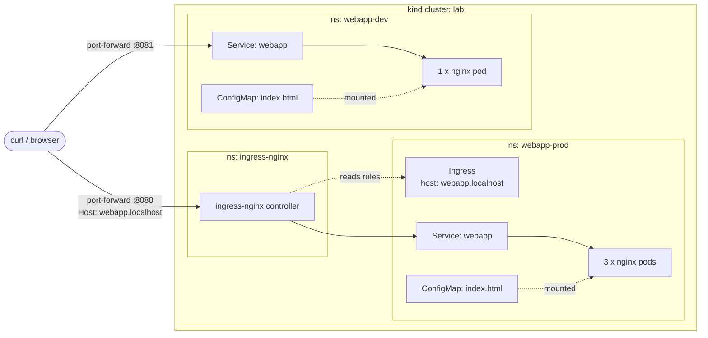
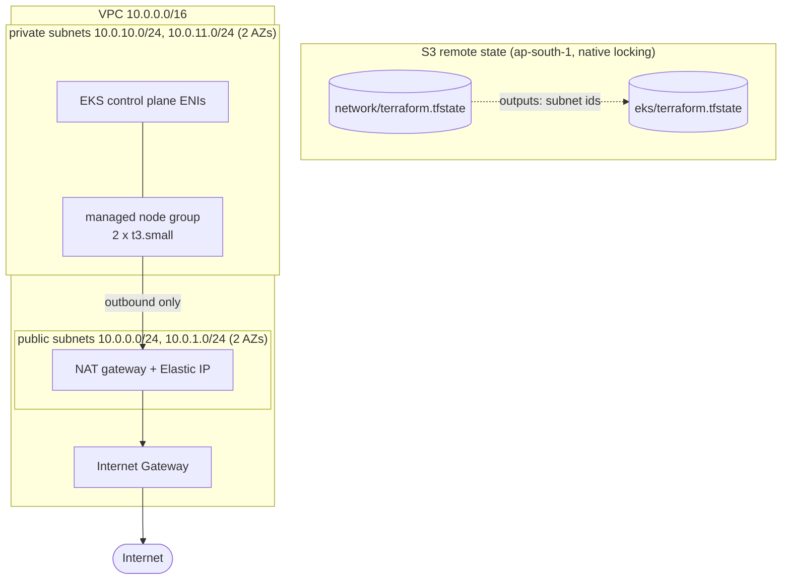
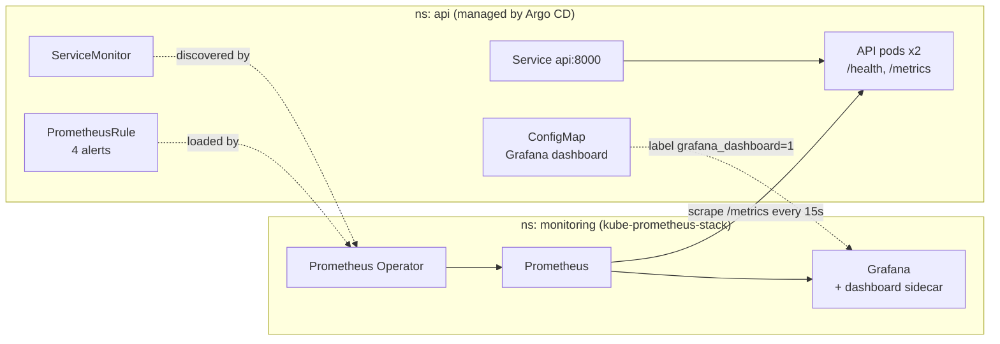
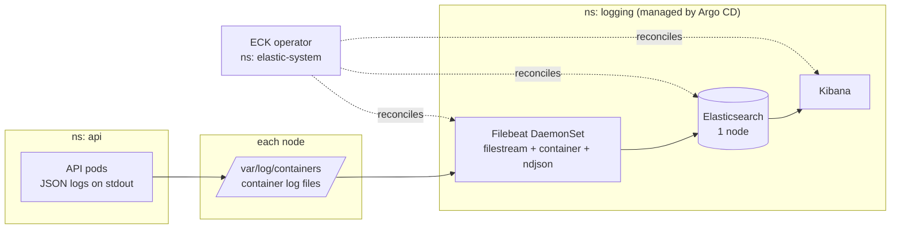
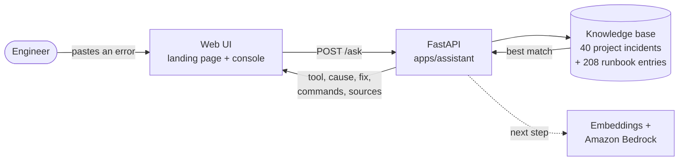

# EKS GitOps Platform

A hands-on DevOps portfolio project, built in stages: a Helm-packaged web app running on Kubernetes, growing into Terraform-provisioned AWS EKS, CI/CD with GitHub Actions and Argo CD, and an LLM-powered RAG service.

> **Current status:** Stages 1 to 3 and observability are complete. Stage 4 is in progress: **ExitZero**, a troubleshooting assistant with a web UI and a 248-entry runbook knowledge base, runs locally ([details](#troubleshooting-assistant-exitzero-stage-4-in-progress)).

## Tech stack

| Area | Tools |
|---|---|
| Containers & orchestration | Kubernetes, kind, ingress-nginx, metrics-server |
| Packaging | Helm 3 (custom chart, values schema) |
| Infrastructure as Code | Terraform *(Stage 2)* |
| Cloud | AWS: VPC, EKS, S3, ECR, Bedrock *(Stages 2–4)* |
| CI/CD | GitHub Actions, Argo CD *(Stage 3)* |
| Observability | Prometheus, Grafana, Elasticsearch, Kibana, Filebeat (ECK) |
| AI assistant | FastAPI + static web UI, runbook retrieval, Amazon Bedrock planned *(Stage 4)* |

## Repository layout

```
.
├── charts/webapp/      # Helm chart (templates, defaults, values schema)
├── envs/
│   ├── dev/values.yaml  # dev overrides: 1 replica, debug logging
│   └── prod/values.yaml # prod overrides: 3 replicas, Ingress, bigger resources
├── infra/terraform/
│   ├── bootstrap/       # ECR repos, GitHub OIDC provider, CI IAM roles
│   ├── network/         # Stage 2: VPC, subnets, IGW, NAT
│   └── eks/             # Stage 2: EKS cluster, node group, IAM roles
├── .github/workflows/   # ci (API image), helm (chart lint + push), terraform-plan (PRs)
├── argocd/applications/ # Argo CD Application manifests (webapp dev/prod, api)
├── k8s/api/             # API Deployment, Service, ServiceMonitor, alert rules, dashboard
├── monitoring/          # kube-prometheus-stack Helm values (kind)
├── logging/             # Elasticsearch, Kibana, Filebeat (ECK custom resources, kind)
├── apps/api/            # FastAPI service (/health, /metrics)
├── apps/assistant/      # Stage 4: ExitZero troubleshooting assistant (FastAPI + web UI)
│   ├── app/             # API (/ask, /tools), knowledge loader, pages, CSS/JS
│   └── knowledge/       # runbooks: 16 tool files + Platform API alert runbooks
└── scripts/             # helper scripts
```
## Architecture (Stage 1)


## Run it locally

### Prerequisites

- Docker Desktop
- [kind](https://kind.sigs.k8s.io/), kubectl, Helm 3
- A kind cluster with [ingress-nginx](https://kubernetes.github.io/ingress-nginx/) installed (needed for prod only)

### Quick start (PowerShell)

```powershell
.\scripts\deploy.ps1 -Env dev     # or -Env prod
.\scripts\teardown.ps1            # removes both environments (or -Env dev / -Env prod)
```

The scripts wrap the Helm commands below. `deploy.ps1` waits until pods are Ready (`--wait`), and `teardown.ps1` uninstalls the release and deletes its namespace. Both are safe to run repeatedly.

### Deploy dev

```powershell
helm upgrade --install webapp charts/webapp -n webapp-dev --create-namespace -f envs/dev/values.yaml
kubectl port-forward -n webapp-dev svc/webapp 8081:80
```

In a second terminal:

```powershell
curl.exe -s http://localhost:8081
```

### Deploy prod

```powershell
helm upgrade --install webapp charts/webapp -n webapp-prod --create-namespace -f envs/prod/values.yaml
kubectl port-forward -n ingress-nginx svc/ingress-nginx-controller 8080:80
```

In a second terminal:

```powershell
curl.exe -s http://webapp.localhost:8080
```

### Clean up

```powershell
helm uninstall webapp -n webapp-dev
helm uninstall webapp -n webapp-prod
kubectl delete namespace webapp-dev webapp-prod
```
## Environments

One chart, two environments. Each `envs/<env>/values.yaml` overrides only what differs from the chart defaults.

| Setting | dev | prod |
|---|---|---|
| Replicas | 1 | 3 |
| `LOG_LEVEL` | debug | warn |
| Resources | chart defaults | larger requests/limits |
| Access | `kubectl port-forward` to the Service | Ingress at `webapp.localhost` |
| Namespace | `webapp-dev` | `webapp-prod` |

Values are merged in order: chart `values.yaml` → `envs/<env>/values.yaml` → any `--set` flags. The merged result is validated against `charts/webapp/values.schema.json` before anything is rendered.
## Infrastructure on AWS (Stage 2)



Two separate root modules, each with its own state: `network` (cheap to keep, rarely changes) and `eks` (expensive, created and destroyed per session). `eks` reads the subnet IDs from the `network` state with `terraform_remote_state`, so the VPC can stay up while the cluster is torn down.

| Module | Creates | Cost while running |
|---|---|---|
| `network` | VPC, 2 public + 2 private subnets, Internet Gateway, route tables, 1 NAT gateway + Elastic IP | NAT gateway is billed hourly |
| `eks` | EKS cluster, cluster and node IAM roles, managed node group of 2 x t3.small | control plane + 2 nodes billed hourly |

This ran end to end in lab sessions: the Helm chart from Stage 1 was deployed to the EKS cluster and served through it, then everything was destroyed and checked clean. The cluster is not kept running; bring it up with `network` first, then `eks`, and tear down in the reverse order.

## CI/CD and GitOps (Stage 3)


| Workflow | Triggers on | What it does |
|---|---|---|
| `ci` | `apps/api/**` | Builds the API image, fails on HIGH/CRITICAL CVEs (Trivy), pushes to ECR on `main` only |
| `helm` | `charts/**`, `envs/**` | `helm lint --strict` and `helm template` for dev and prod; on `main`, packages the chart and pushes it to ECR as an OCI artifact |
| `terraform-plan` | `infra/terraform/**` on PRs | `fmt -check`, `init`, `validate`, `plan -lock=false` using a read-only role |

| IAM role | Can be assumed by | Permissions |
|---|---|---|
| `github-actions-terraform` | workflows on `refs/heads/main` only | push to the two ECR repos, state bucket access |
| `github-actions-plan` | pull request workflows only | AWS `ReadOnlyAccess` (no state writes, so plans run without locking) |

### Argo CD (local, kind)

```powershell
helm repo add argo https://argoproj.github.io/argo-helm
helm upgrade --install argocd argo/argo-cd --version 10.11.6 -n argocd --create-namespace `
  --set global.networkPolicy.create=false
kubectl apply -f argocd/applications/
```

Each Application points at `charts/webapp` on `main` with its `envs/<env>/values.yaml`, and syncs automatically. Prod overrides the Ingress host to `gitops-prod.localhost` so it does not clash with the Stage 1 release. Argo deploys into separate namespaces (`gitops-dev`, `gitops-prod`), so the Stage 1 releases stay untouched.

### GitOps demo (verified)

| Test | What I did | Result |
|---|---|---|
| Self-heal | `kubectl scale deploy webapp-dev -n gitops-dev --replicas=3` (manual change, bypassing Git) | Argo scaled it back to 1 within the same second; the extra pods lived under a second |
| Git change | Set `replicaCount: 2` in `envs/dev/values.yaml` and pushed to `main` | Argo synced and `gitops-dev` ran 2 pods about 68 s after the commit (default poll is 3 min) |

## Observability (Prometheus + Grafana)



The monitoring stack is installed with Helm (`monitoring/kube-prometheus-stack-values.yaml`). Everything about the API (Deployment, Service, ServiceMonitor, alert rules and the dashboard) lives in `k8s/api/` and is deployed by Argo CD, so monitoring is configured as code next to the service it watches.

| Alert | Fires when | Severity |
|---|---|---|
| `ApiTargetDown` | a pod is not scraped for 1 min | critical |
| `ApiNoTargets` | no API targets for 2 min | critical |
| `ApiHighErrorRate` | more than 5% of requests return 5xx for 2 min | warning |
| `ApiHighLatency` | p95 latency above 500 ms for 5 min | warning |

The "API overview" dashboard shows pods up, requests per second, 5xx rate, p95 latency, request rate by handler and status, latency percentiles, and scrape status per pod.

**Failure drill (verified):** scaling the API to 0 with auto-sync paused made `ApiNoTargets` go pending at about 1 min and fire at about 3 min; restoring auto-sync brought both pods back in 11 s and the alert resolved. With self-heal on, the same change is reverted in under 5 s and no alert fires. Triage steps are in the [Platform API runbooks](apps/assistant/knowledge/platform-api.md).

## Logging (ELK)



The Elastic Cloud on Kubernetes (ECK) operator is installed with Helm (`elastic/eck-operator`); the `Elasticsearch`, `Kibana` and `Beat` custom resources in `logging/` are deployed by Argo CD. Filebeat reads only the `api` namespace, strips the container runtime wrapper, and decodes each JSON line, so `levelname`, `name` and `message` are searchable fields next to the Kubernetes metadata (pod, node, namespace).

Cluster health reads `yellow` once Filebeat's index exists: with one node the replica shards have nowhere to be placed, so they stay unassigned (the data is complete and searchable). For a single-node lab set the index replicas to 0; in production run at least three nodes.

This runs on the kind cluster only (about 2.5 GB of memory). The versions are pinned to 9.5.5, the newest stack version whose images exist on `docker.elastic.co`. Triage steps for a 404 spike are in the [Platform API runbooks](apps/assistant/knowledge/platform-api.md).

## Troubleshooting assistant: ExitZero (Stage 4, in progress)

ExitZero takes a pasted error from any tool in the stack, works out which tool it came from, and answers with the likely cause, the fix, copyable commands and the source it came from. When nothing matches it says "not in my runbooks yet" instead of guessing.



| Part | What it does |
|---|---|
| `apps/assistant/knowledge/*.md` | 208 runbook entries in a strict format (exact error strings, cause, fix, commands): Kubernetes, Docker, Linux, AWS/EKS/ECR, GCP/GKE, Azure/AKS, Terraform, Helm, Argo CD, GitHub Actions, GitLab CI, Jenkins, Git, networking/TLS/Nginx, Postgres, MySQL, Redis, MongoDB, Prometheus, Grafana, Loki, Elasticsearch, Datadog, OpenTelemetry, Ansible, Vault, Kafka, Istio, plus this repo's Platform API alert runbooks with their drill records |
| `apps/assistant/app/kb.py` | 40 real incidents from building this platform and from the course labs, plus the loader that parses the runbook files (46 tools in total) |
| `POST /ask` | Returns `found`, the detected `tool`, `cause`, `fix`, `commands`, `related` entries and `sources` |
| Web UI | Landing page with a live demo box, a console, and a sign-in page that is a design mock (no accounts). A small bot in the console reacts to what is happening: thinking while it searches, happy on a match, a shrug when nothing matches. Commands copy with one click |

**Run it locally**

```powershell
cd apps/assistant
python -m venv .venv
.\.venv\Scripts\Activate.ps1
pip install -r requirements.txt
uvicorn app.main:app --port 8001
```

Then open http://localhost:8001 (landing page) or http://localhost:8001/app (console).

**How matching works today:** each entry lists the exact error strings it covers. The best entry is the one with the most matched strings, then the longest (most specific) match. Tested on 46 realistic error messages across every tool (46/46 correct), and 247 of 248 entries are found by their own error text (the one exception, `AssumeRoleWithWebIdentity`, genuinely fits both GitHub OIDC and EKS IRSA, so the answer lists the other under "Also similar").

**Next:** embedding-based retrieval so errors worded differently still match, a Dockerfile and Argo CD Application, an evaluation set, then Amazon Bedrock to write the answer (blocked for now at the AWS account level, so the backend is pluggable).

## Design decisions

- **No long-lived cloud credentials in CI.** Workflows assume IAM roles through GitHub's OIDC provider. The trust policy pins the exact `sub` claim: only `main` can push images, and pull requests can only assume a read-only role. Forked PRs get no OIDC token at all.
- **Immutable image and chart tags, tagged by commit.** ECR repos are `IMMUTABLE`, and tags are the git SHA, so a tag always points at exactly one build and a re-run cannot silently overwrite it.
- **Scan before publish.** The Trivy scan runs before the push step, so an image with fixable HIGH/CRITICAL CVEs never reaches the registry.

- **Config changes trigger a rollout.** The Deployment's pod template carries a `checksum/config` annotation (a sha256 of the rendered ConfigMap). Changing the page content changes the hash, which changes the pod template, so Kubernetes rolls out new pods. Without it, pods would keep serving the old content until manually restarted.
- **Stable selector labels.** Selectors use only `app.kubernetes.io/name` and `app.kubernetes.io/instance`. Labels that change between releases (chart version, app version) are kept out of selectors, because a Deployment's selector is immutable, and changing it would make `helm upgrade` fail.
- **`env` is a map, not a list.** A map (`LOG_LEVEL: debug`) lets an environment override a single variable. With a list, Helm replaces the whole list, so overriding one variable means repeating all of them.
- **Feature flags as config.** `FEATURE_BANNER` is an ordinary environment variable, so a feature can be toggled per environment without building a new image.
- **Validated input.** `values.schema.json` rejects wrong types, unknown top-level keys, and invalid enums (e.g. `environment` must be `dev` or `prod`) at lint and install time.
- **Release-aware naming.** Resource names use the release name, plus the chart name only when the release name doesn't already contain it (avoiding names like `webapp-webapp`).
## Troubleshooting notes

Real issues hit while building this, and how they were fixed.

| Symptom | Cause | Fix |
|---|---|---|
| Image pulls from Docker Hub reset on a home connection | ISP's IPv6 route to the CDN resets connections | Prefer IPv4: `netsh interface ipv6 set prefixpolicy ::ffff:0:0/96 60 4` |
| Pods stuck in `ErrImagePull` on kind | Image not reachable from the kind nodes | Pull locally, then `kind load image-archive` into the cluster |
| HTTPS returns "Kubernetes Ingress Controller Fake Certificate" | TLS Secret missing, wrong name, or host not listed under `tls.hosts` | Check the Secret exists in the Ingress's namespace and the host matches |
| `kubectl top` fails with metrics not available | metrics-server can't verify kubelet certs on kind | Add `--kubelet-insecure-tls` (local clusters only) |
| `env` value `off` becomes `false` | YAML 1.1 parses `on/off/yes/no` as booleans | Quote it: `"off"`; the schema now rejects non-string env values |
| `helm upgrade` fails: `field is immutable` | Selector labels changed between releases | Keep selectors limited to stable labels |
| `curl` in PowerShell behaves differently | `curl` is an alias for `Invoke-WebRequest` | Use `curl.exe` |
| `Could not assume role with OIDC: Not authorized` although the trust policy looks right | The repo uses immutable subject claims, so `sub` is `repo:owner@id/name@id:ref:...` | Match the prefix from `gh api repos/OWNER/REPO/actions/oidc/customization/sub` |
| `terraform init` in CI: provider checksum does not match the lock file | `.terraform.lock.hcl` was created on Windows and only has the Windows hash | Add the Linux hash: `terraform providers lock -platform=linux_amd64`, commit the file |
| Trivy fails the build on HIGH CVEs in starlette | The old pinned FastAPI pulled a vulnerable starlette | Bump FastAPI and the metrics instrumentator together |
| Elastic pods `ImagePullBackOff` with `NotFound` for the image tag | The version exists in the release list but its images were never published to `docker.elastic.co` | Check the tag first: `docker manifest inspect docker.elastic.co/elasticsearch/elasticsearch:<ver>`; pin the newest version that has all three images |
| Changing an ECK resource to a lower version is rejected: `Version downgrades are not supported` | The ECK admission webhook blocks downgrades | If nothing has run yet, delete the Elasticsearch, Kibana and Beat objects (and the empty PVC) and let Argo recreate them |
| Argo CD app stays `OutOfSync` after a failed sync, nothing retries | Auto-sync does not retry a commit whose last sync failed | Fix the cause, then trigger a sync: `kubectl -n argocd patch application <app> --type merge -p '{"operation":{"sync":{}}}'` |
| Filebeat 9 runs but no harvester starts: `Container input is deprecated` | The `container` input type was removed in 9.x | Use `type: filestream` with a unique `id`, `prospector.scanner.symlinks: true` and the `container` parser |
| Argo CD apps stuck on `Unknown`, API server i/o timeout | The Argo chart's NetworkPolicies are enforced by kind's CNI and block the controller | Local only: `--set global.networkPolicy.create=false`, then restart the Argo pods. Keep the policies on EKS |
## Roadmap

- [x] **Stage 1: Kubernetes + Helm.** Custom chart, dev/prod values, values schema, local kind deployment
- [x] **Stage 2: Terraform on AWS.** VPC and EKS as two root modules, S3 remote state with locking, the same chart deployed and served on EKS, then destroyed to save cost
- [x] **Stage 3: CI/CD.** API image build, Trivy scan and push to ECR via GitHub OIDC; `helm lint`/`helm template` and chart push to ECR; `terraform plan` on PRs with a read-only role; Argo CD on kind with dev and prod Applications, GitOps drift and self-heal verified
- [x] **Observability.** Prometheus + Grafana on kind with an API ServiceMonitor, dashboard, 4 alert rules, failure drill and runbook; ELK (ECK operator, Elasticsearch, Kibana, Filebeat) for structured API logs
- [ ] **Stage 4: AI service.** A small Amazon Bedrock RAG service deployed on EKS (LLMOps)
  - [x] ExitZero web UI and API, 248-entry runbook knowledge base, tool detection, copyable commands
  - [ ] Embedding retrieval, evaluation set, container image and Argo CD deployment
  - [ ] Amazon Bedrock answers (waiting on account access)