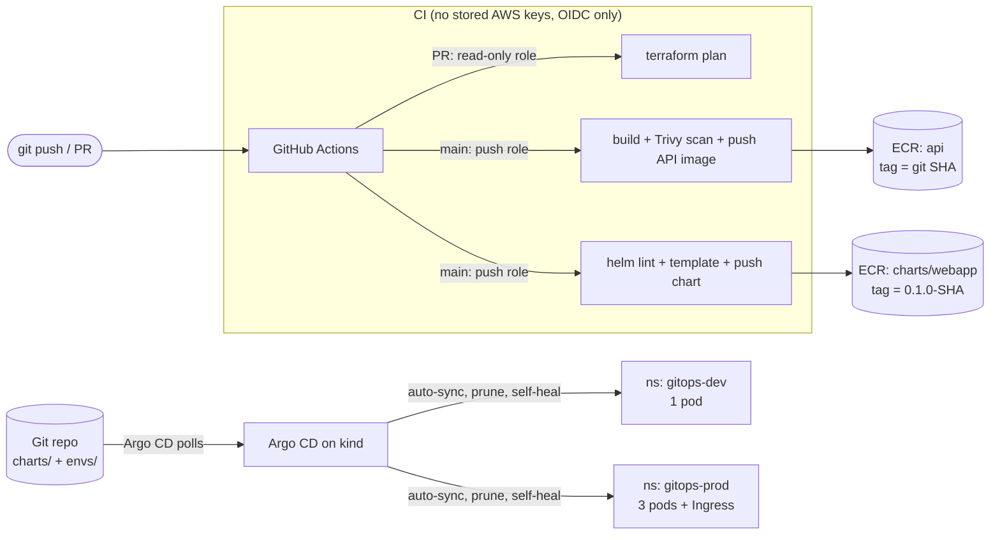

# EKS GitOps Platform

A hands-on DevOps portfolio project, built in stages: a Helm-packaged web app running on Kubernetes, growing into Terraform-provisioned AWS EKS, CI/CD with GitHub Actions and Argo CD, and an LLM-powered RAG service.

> **Current status:** Stage 1 complete: Helm chart deployed to a local kind cluster with separate dev and prod configurations.

## Tech stack

| Area | Tools |
|---|---|
| Containers & orchestration | Kubernetes, kind, ingress-nginx, metrics-server |
| Packaging | Helm 3 (custom chart, values schema) |
| Infrastructure as Code | Terraform *(Stage 2)* |
| Cloud | AWS: VPC, EKS, S3, ECR, Bedrock *(Stages 2–4)* |
| CI/CD | GitHub Actions, Argo CD *(Stage 3)* |

## Repository layout

```
.
├── charts/webapp/      # Helm chart (templates, defaults, values schema)
├── envs/
│   ├── dev/values.yaml  # dev overrides: 1 replica, debug logging
│   └── prod/values.yaml # prod overrides: 3 replicas, Ingress, bigger resources
├── infra/terraform/     # bootstrap: ECR repos, GitHub OIDC provider, IAM roles (VPC + EKS planned)
├── .github/workflows/   # ci (API image), helm (chart lint + push), terraform-plan (PRs)
├── argocd/applications/ # Argo CD Application manifests (dev, prod)
├── apps/api/            # FastAPI service (/health, /metrics); Stage 4 RAG service planned
├── scripts/             # helper scripts
└── docs/                # extra documentation
```
## Architecture (Stage 1)


## Run it locally

### Prerequisites

- Docker Desktop
- [kind](https://kind.sigs.k8s.io/), kubectl, Helm 3
- A kind cluster with [ingress-nginx](https://kubernetes.github.io/ingress-nginx/) installed (needed for prod only)

### Quick start (PowerShell)

```powershell
.\scripts\deploy.ps1 -Env dev     # or -Env prod
.\scripts\teardown.ps1            # removes both environments (or -Env dev / -Env prod)
```

The scripts wrap the Helm commands below. `deploy.ps1` waits until pods are Ready (`--wait`), and `teardown.ps1` uninstalls the release and deletes its namespace. Both are safe to run repeatedly.

### Deploy dev

```powershell
helm upgrade --install webapp charts/webapp -n webapp-dev --create-namespace -f envs/dev/values.yaml
kubectl port-forward -n webapp-dev svc/webapp 8081:80
```

In a second terminal:

```powershell
curl.exe -s http://localhost:8081
```

### Deploy prod

```powershell
helm upgrade --install webapp charts/webapp -n webapp-prod --create-namespace -f envs/prod/values.yaml
kubectl port-forward -n ingress-nginx svc/ingress-nginx-controller 8080:80
```

In a second terminal:

```powershell
curl.exe -s http://webapp.localhost:8080
```

### Clean up

```powershell
helm uninstall webapp -n webapp-dev
helm uninstall webapp -n webapp-prod
kubectl delete namespace webapp-dev webapp-prod
```
## Environments

One chart, two environments. Each `envs/<env>/values.yaml` overrides only what differs from the chart defaults.

| Setting | dev | prod |
|---|---|---|
| Replicas | 1 | 3 |
| `LOG_LEVEL` | debug | warn |
| Resources | chart defaults | larger requests/limits |
| Access | `kubectl port-forward` to the Service | Ingress at `webapp.localhost` |
| Namespace | `webapp-dev` | `webapp-prod` |

Values are merged in order: chart `values.yaml` → `envs/<env>/values.yaml` → any `--set` flags. The merged result is validated against `charts/webapp/values.schema.json` before anything is rendered.
## CI/CD and GitOps (Stage 3)



| Workflow | Triggers on | What it does |
|---|---|---|
| `ci` | `apps/api/**` | Builds the API image, fails on HIGH/CRITICAL CVEs (Trivy), pushes to ECR on `main` only |
| `helm` | `charts/**`, `envs/**` | `helm lint --strict` and `helm template` for dev and prod; on `main`, packages the chart and pushes it to ECR as an OCI artifact |
| `terraform-plan` | `infra/terraform/**` on PRs | `fmt -check`, `init`, `validate`, `plan -lock=false` using a read-only role |

| IAM role | Can be assumed by | Permissions |
|---|---|---|
| `github-actions-terraform` | workflows on `refs/heads/main` only | push to the two ECR repos, state bucket access |
| `github-actions-plan` | pull request workflows only | AWS `ReadOnlyAccess` (no state writes, so plans run without locking) |

### Argo CD (local, kind)

```powershell
helm repo add argo https://argoproj.github.io/argo-helm
helm upgrade --install argocd argo/argo-cd --version 10.11.6 -n argocd --create-namespace `
  --set global.networkPolicy.create=false
kubectl apply -f argocd/applications/
```

Each Application points at `charts/webapp` on `main` with its `envs/<env>/values.yaml`, and syncs automatically. Prod overrides the Ingress host to `gitops-prod.localhost` so it does not clash with the Stage 1 release. Argo deploys into separate namespaces (`gitops-dev`, `gitops-prod`), so the Stage 1 releases stay untouched.

## Design decisions

- **No long-lived cloud credentials in CI.** Workflows assume IAM roles through GitHub's OIDC provider. The trust policy pins the exact `sub` claim: only `main` can push images, and pull requests can only assume a read-only role. Forked PRs get no OIDC token at all.
- **Immutable image and chart tags, tagged by commit.** ECR repos are `IMMUTABLE`, and tags are the git SHA, so a tag always points at exactly one build and a re-run cannot silently overwrite it.
- **Scan before publish.** The Trivy scan runs before the push step, so an image with fixable HIGH/CRITICAL CVEs never reaches the registry.

- **Config changes trigger a rollout.** The Deployment's pod template carries a `checksum/config` annotation (a sha256 of the rendered ConfigMap). Changing the page content changes the hash, which changes the pod template, so Kubernetes rolls out new pods. Without it, pods would keep serving the old content until manually restarted.
- **Stable selector labels.** Selectors use only `app.kubernetes.io/name` and `app.kubernetes.io/instance`. Labels that change between releases (chart version, app version) are kept out of selectors, because a Deployment's selector is immutable, and changing it would make `helm upgrade` fail.
- **`env` is a map, not a list.** A map (`LOG_LEVEL: debug`) lets an environment override a single variable. With a list, Helm replaces the whole list, so overriding one variable means repeating all of them.
- **Feature flags as config.** `FEATURE_BANNER` is an ordinary environment variable, so a feature can be toggled per environment without building a new image.
- **Validated input.** `values.schema.json` rejects wrong types, unknown top-level keys, and invalid enums (e.g. `environment` must be `dev` or `prod`) at lint and install time.
- **Release-aware naming.** Resource names use the release name, plus the chart name only when the release name doesn't already contain it (avoiding names like `webapp-webapp`).
## Troubleshooting notes

Real issues hit while building this, and how they were fixed.

| Symptom | Cause | Fix |
|---|---|---|
| Image pulls from Docker Hub reset on a home connection | ISP's IPv6 route to the CDN resets connections | Prefer IPv4: `netsh interface ipv6 set prefixpolicy ::ffff:0:0/96 60 4` |
| Pods stuck in `ErrImagePull` on kind | Image not reachable from the kind nodes | Pull locally, then `kind load image-archive` into the cluster |
| HTTPS returns "Kubernetes Ingress Controller Fake Certificate" | TLS Secret missing, wrong name, or host not listed under `tls.hosts` | Check the Secret exists in the Ingress's namespace and the host matches |
| `kubectl top` fails with metrics not available | metrics-server can't verify kubelet certs on kind | Add `--kubelet-insecure-tls` (local clusters only) |
| `env` value `off` becomes `false` | YAML 1.1 parses `on/off/yes/no` as booleans | Quote it: `"off"`; the schema now rejects non-string env values |
| `helm upgrade` fails: `field is immutable` | Selector labels changed between releases | Keep selectors limited to stable labels |
| `curl` in PowerShell behaves differently | `curl` is an alias for `Invoke-WebRequest` | Use `curl.exe` |
| `Could not assume role with OIDC: Not authorized` although the trust policy looks right | The repo uses immutable subject claims, so `sub` is `repo:owner@id/name@id:ref:...` | Match the prefix from `gh api repos/OWNER/REPO/actions/oidc/customization/sub` |
| `terraform init` in CI: provider checksum does not match the lock file | `.terraform.lock.hcl` was created on Windows and only has the Windows hash | Add the Linux hash: `terraform providers lock -platform=linux_amd64`, commit the file |
| Trivy fails the build on HIGH CVEs in starlette | The old pinned FastAPI pulled a vulnerable starlette | Bump FastAPI and the metrics instrumentator together |
| Argo CD apps stuck on `Unknown`, API server i/o timeout | The Argo chart's NetworkPolicies are enforced by kind's CNI and block the controller | Local only: `--set global.networkPolicy.create=false`, then restart the Argo pods. Keep the policies on EKS |
## Roadmap

- [x] **Stage 1: Kubernetes + Helm.** Custom chart, dev/prod values, values schema, local kind deployment
- [ ] **Stage 2: Terraform on AWS.** VPC and EKS, S3 remote state with locking, deploy the same chart to EKS
- [ ] **Stage 3: CI/CD.** In progress. Done: API image build, Trivy scan and push to ECR via GitHub OIDC; `helm lint`/`helm template` and chart push to ECR; `terraform plan` on PRs with a read-only role; Argo CD on kind with dev and prod Applications synced. Left: GitOps drift and self-heal demo, then tick this box
- [ ] **Stage 4: AI service.** A small Amazon Bedrock RAG service deployed on EKS (LLMOps)